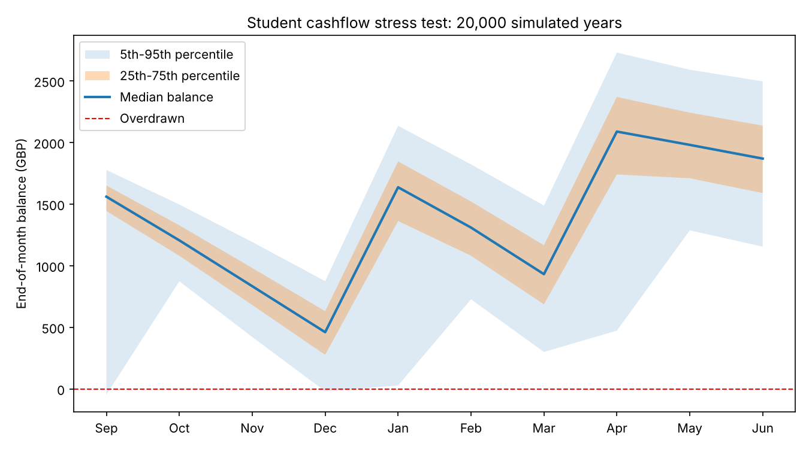

# Fred Seaman

**Economics and Finance student, applying for placements.**
I learn by building. Each project below takes a real money problem, such as a student's cashflow or a startup's unit economics, and turns it into a working model with the assumptions and limits written down.

[LinkedIn](https://www.linkedin.com/in/YOUR-LINKEDIN) · [Email](mailto:YOUR-EMAIL)

---

## Start here: Student Cashflow Stress-Tester

A Monte Carlo simulation of 20,000 academic years. It answers: *given my income and spending, what is the chance I run out of money, in which month, and how big a buffer do I need?*

In the default scenario it finds about a **16% chance of an overdraft**, concentrated in September, December and January, and shows that roughly **£200 of extra buffer or 12.5 hours a week** brings that under 5%.

[Read the project](cashflow-stress-tester/)

---

## Projects

| Project | What it shows | Tools |
|---|---|---|
| [**Student Cashflow Stress-Tester**](cashflow-stress-tester/) | Risk modelling: simulation, probability of ruin, scenario analysis | Python, NumPy, Matplotlib |
| [**Semester Budget Planner**](semester-budget-planner/) | Cashflow forecasting: timing risk, tiered costs, one output (hours of work per week) | Financial modelling, assumptions design |
| [**Ironroot: startup concept and MVP**](ironroot/) | Product and unit economics: business case, pricing hypotheses, break-even, roadmap | JavaScript, HTML, spreadsheet-style modelling |

The planner sets the **plan**. The stress-tester puts **uncertainty** around it. Ironroot applies the same thinking to a business.

## How I work

- **Assumptions stated.** Every README lists what the model assumes and where it is likely wrong.
- **Tested before shared.** Code is run end to end, and numbers in the READMEs come from real runs.
- **Honest about status.** These are personal projects. None has real customers or revenue.

## Skills

Python (NumPy, Matplotlib), Monte Carlo simulation, cashflow forecasting, financial modelling, unit economics, JavaScript and HTML.

---

*Personal projects built to learn and demonstrate skills. Illustrative figures are labelled as such.*
