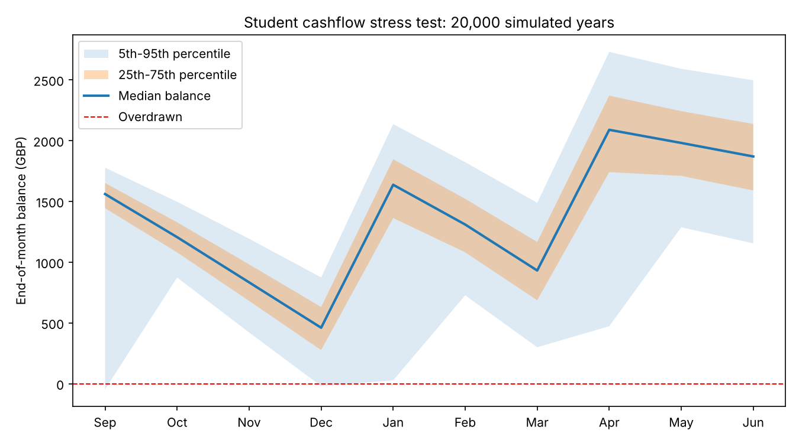

# Student Cashflow Stress-Tester

A Monte Carlo simulation that answers a question every student asks and almost nobody can answer:

> **Given my income and spending, what is the probability I run out of money, when is it most likely to happen, and how big a buffer do I need?**



*Shaded bands show the 25th-75th and 5th-95th percentile of 20,000 simulated years. The dashed line is zero.*

## Why it exists

A budget that balances over the year can still hit zero in December. Student finance arrives in three lumps (roughly September, January and April) while rent leaves every month. Averages hide that timing risk. This tool models the timing and the uncertainty instead of assuming everything goes to plan.

## Example result (default scenario)

10 hours a week at £11.50, £75 a month from family, £350 opening savings, £470 rent.

| Output | Result |
|---|---|
| Probability of ever being overdrawn | **16.0%** |
| Riskiest months | Sep (6.7%), Dec (5.6%), Jan (4.6%) |
| Buffer needed for 95% safety | about **£200** |
| Weekly hours needed for 5% risk or lower | **12.5** |

## What it models

- **Money in:** three student finance instalments, each with a 12% chance of arriving a month late; family support; part-time earnings that vary month to month and fall during May and June exams.
- **Money out, in three tiers:** locked costs (rent for 8 months, bills for 9), living costs, and discretionary spend, all with random variation.
- **Shocks:** unexpected costs such as a broken laptop or an emergency train ticket, arriving randomly (Poisson arrivals, exponentially distributed sizes).

## How to run

```bash
pip install -r requirements.txt
python stress_tester.py --plot
python stress_tester.py --hours 14 --savings 600 --rent 520
```

Options: `--hours`, `--savings`, `--rent`, `--family`, `--sims`, `--plot`. All other assumptions sit in the `Plan` dataclass at the top of `stress_tester.py`. Results are reproducible (fixed random seed).

## Method

For each simulated year the model steps through September to June, updating the balance with that month's random inflows and outflows. Earnings and spending use normal noise clipped at zero. Delayed student finance is carried into the next month. Statistics are then taken across all simulated years. The safety buffer is the 5th percentile of each year's lowest balance. Required hours are found by searching in half-hour steps until the overdraft probability falls to 5% or below.

## Limitations (read before trusting a number)

- Default inputs are **illustrative, not calibrated to real data**. Replace them with your own figures.
- Months are independent apart from the running balance. In reality shocks cluster, for example illness lowers earnings and raises costs together.
- Overdraft charges, interest, tax and benefits are not modelled.
- The noise levels are assumptions, not estimates from data.

## Possible extensions

- Calibrate noise from anonymised real spending data
- Add correlated shocks and overdraft interest
- Wrap it in a Streamlit app so non-programmers can use it
- Compare strategies, such as front-loading shifts before December versus steady hours

## Licence

MIT, see the [LICENSE](../LICENSE) file.
